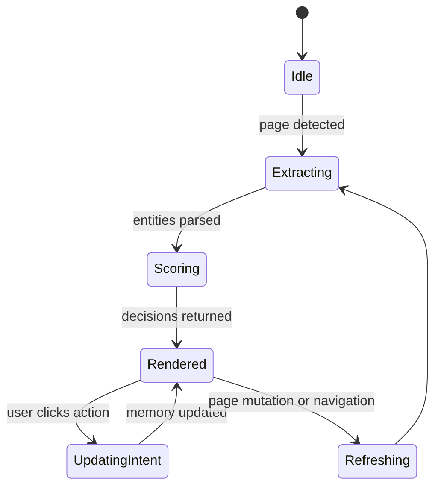

# RecoMe Extension Spec

## Objective

Build a browser extension that improves e-commerce recommendations by extracting page entities, showing user-facing guidance, and capturing explicit intent.

## Primary MVP Surface

- Amazon search results pages
- Amazon product detail pages

## User Value

The extension should help users:

- understand why products are being shown
- declare intent directly on recommendations and products
- reduce repeated irrelevant recommendations
- mark categories, products, brands, and sellers with durable preference signals

## Core User Stories

- As a shopper, I want to mark a product as not relevant so I stop seeing similar suggestions.
- As a shopper, I want to mark a product as already bought so it stops polluting recommendations.
- As a shopper, I want to signal that I am only researching so the system does not overfit to one click.
- As a shopper, I want short explanations for badges so I know why RecoMe changed something.
- As a shopper, I want the extension to work without creating an account.

## Surfaces

### Search Results Page

Behaviors:

- detect product cards
- extract product metadata
- score each product candidate
- add lightweight badges
- expose quick actions

### Product Detail Page

Behaviors:

- extract product, brand, seller, price, category, and availability
- show a recommendation assessment panel
- allow detailed intent declaration
- display explanation and related memory signals

## Extension Modules

### 1. Site Adapter Registry

Responsibilities:

- map hostname and page pattern to adapter
- expose extraction methods per page type

Example interface:

```ts
interface SiteAdapter {
  canHandle(url: string): boolean;
  detectPageType(document: Document): 'search' | 'product' | 'unknown';
  extractPageContext(document: Document): PageContext;
  extractEntities(document: Document): ExtractedEntity[];
  getMountTargets(document: Document): MountTargets;
}
```

### 2. Entity Extraction Pipeline

Responsibilities:

- parse DOM
- normalize text values
- identify products, brands, sellers, prices, ratings, and delivery cues
- generate stable temporary IDs before canonical resolution

Pipeline steps:

1. DOM snapshot or selective DOM read
2. adapter extraction
3. field normalization
4. candidate validation
5. canonicalization request to brain
6. scoring request

### 3. Overlay UI

Responsibilities:

- inject badges near product cards
- inject action tray on product cards or PDP
- render explanation popovers
- provide clear reversible actions

### 4. Popup UI

Responsibilities:

- show recent intents
- allow global contexts like budget mode or research mode
- allow import/export later
- display watchlists later

### 5. Background Worker

Responsibilities:

- orchestrate messages
- coordinate storage
- debounce heavy extraction and scoring
- manage feature flags

## Recommended Intent Actions

Minimum set:

- Interested
- Not interested
- Already bought
- One-time need
- Researching

Recommended next set:

- Prefer this brand
- Avoid this seller
- Quality first
- Budget sensitive

## UI Elements

### Product Card Badge

Examples:

- Good fit
- Consider with caution
- Lower priority
- Already bought similar

Rules:

- badge must be short
- badge must be explainable
- badge color must not be the only signal

### Explanation Popover

Format:

- one sentence primary explanation
- optional secondary details
- recent intent signals if relevant

Example:

- Lower priority because you marked similar gaming headsets as already bought in the last 30 days.

### Action Tray

Suggested actions:

- Interested
- Not interested
- Already bought
- Researching
- Why this?

## Client State Model



## Performance Requirements

- Search result overlays should appear progressively, not block page use.
- Time to first badge should target under 1 second on cached paths.
- Full card set scoring should be debounced for dynamic page loads.
- DOM observers must avoid repeated heavy parsing.

## Error Handling

### Extraction failure

Fallback:

- do not show broken UI
- log adapter failure locally
- show no badge state rather than incorrect badge state

### Scoring failure

Fallback:

- allow intent actions if extraction succeeded
- show neutral UI with no ranking adjustment

### Storage failure

Fallback:

- degrade to session memory if possible
- notify user only if persistent preference saving fails repeatedly

## Data Written by Extension

### PageContext

```ts
type PageContext = {
  site: 'amazon' | 'walmart' | 'ebay' | 'youtube' | 'unknown';
  pageType: 'search' | 'product' | 'feed' | 'unknown';
  url: string;
  query?: string;
  categoryPath?: string[];
  timestamp: string;
};
```

### IntentEvent

```ts
type IntentEvent = {
  id: string;
  createdAt: string;
  source: 'overlay' | 'popup' | 'agent';
  site: string;
  entityType: 'product' | 'brand' | 'seller' | 'category';
  entityId: string;
  intentType:
    | 'interested'
    | 'not_interested'
    | 'already_bought'
    | 'one_time_need'
    | 'researching'
    | 'prefer_brand'
    | 'avoid_seller'
    | 'quality_first'
    | 'budget_sensitive';
  scope: 'entity' | 'category' | 'brand' | 'session';
  expiresAt?: string;
  metadata?: Record<string, unknown>;
};
```

## Acceptance Criteria

- The extension detects Amazon search pages and product pages.
- The extension extracts product entities from visible cards.
- Each visible product can render a badge and explanation when score data exists.
- Users can submit at least five intent actions.
- Intent actions persist across future page visits in local storage.
- Visible recommendation changes are reversible.
- Visible recommendation changes are explainable.

## Out of Scope for v1

- checkout automation
- auto-filling payment details
- multi-retailer canonical search index
- account system requirement
- multi-device sync requirement
