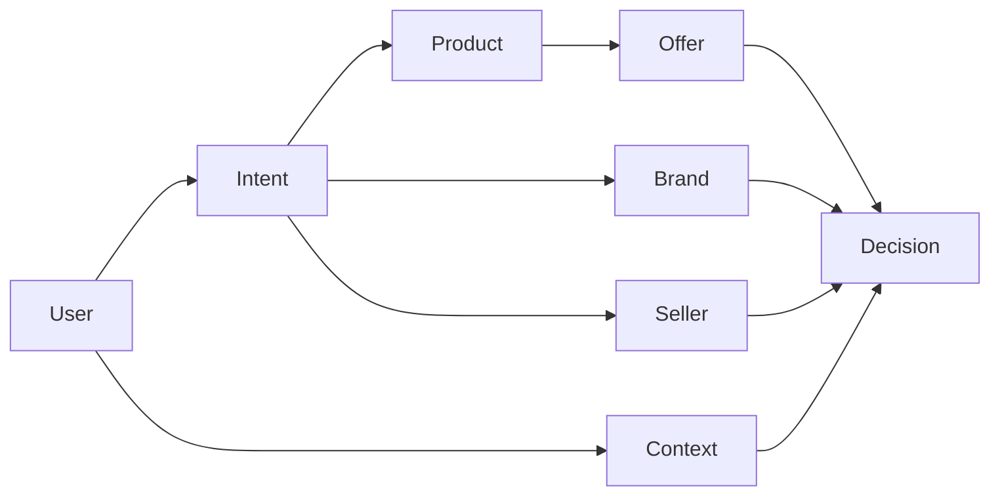
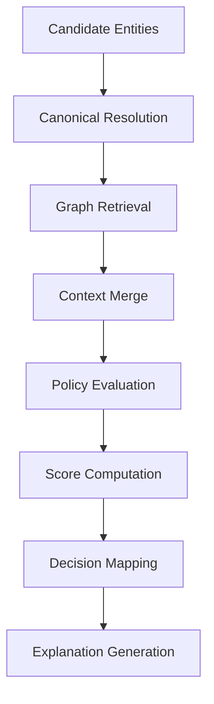

# RecoMe Brain Spec

## Objective

The RecoMe Brain is the shared decision and memory layer. It should maintain a portable preference graph and generate recommendation decisions consistently across extension and agent surfaces.

## Core Responsibilities

- maintain normalized entities
- store explicit user intents
- model contexts and time horizons
- score recommendation candidates
- apply policy rules
- generate human-readable explanations
- persist durable preference memory

## Conceptual Model



## Core Entities

### User

Represents the local user profile.

Fields:

- userId
- profileVersion
- settings
- createdAt
- updatedAt

### Intent

Represents an explicit preference signal.

Examples:

- interested
- not interested
- already bought
- one-time need
- researching
- prefer brand
- avoid seller

### Context

Represents transient or durable mode modifiers.

Examples:

- budget sensitive
- quality first
- gift shopping
- research mode
- seasonal shopping

### Product

Normalized representation of a product concept.

Fields:

- productId
- title
- brandId
- categoryIds
- attributes
- canonicalTokens

### Brand

Normalized brand node.

Fields:

- brandId
- displayName
- aliases

### Seller

Normalized seller node.

Fields:

- sellerId
- displayName
- trustSignals

### Offer

A store-specific listing or purchasable instance.

Fields:

- offerId
- productId
- sellerId
- site
- price
- shipping
- availability
- url

### Decision

A result generated by the engine.

Possible values:

- boost
- neutral
- caution
- suppress

## Graph Edges

### Supported Edge Types

- user -> intent
- intent -> product
- intent -> brand
- intent -> seller
- user -> context
- product -> brand
- offer -> product
- offer -> seller
- decision -> offer

### Edge Properties

- weight
- confidence
- source
- createdAt
- updatedAt
- expiresAt

## Storage Model

Recommended stores:

- users
- products
- brands
- sellers
- offers
- intents
- contexts
- edges
- decisions
- watchlists
- explanation_logs

Recommended implementation:

- IndexedDB with typed repositories

## Scoring Pipeline



## Scoring Inputs

Inputs should include:

- product attributes
- brand affinity or aversion
- seller trust signals
- recent explicit intents
- active user contexts
- recency of similar decisions
- site and page context

## Example Scoring Heuristics

### Positive signals

- recently marked interested in same category
- prefers this brand
- quality-first context aligns with product quality proxy
- watched or saved similar products

### Negative signals

- marked already bought similar item recently
- marked not interested in this category
- seller explicitly avoided
- one-time need expired but category still repeated

### Neutralizing signals

- researching mode should reduce aggressive suppression
- uncertain entity resolution should reduce confidence

## Decision Mapping

Suggested ranges:

- score >= 0.6 => boost
- score between 0.2 and 0.59 => neutral positive
- score between -0.19 and 0.19 => neutral
- score between -0.59 and -0.2 => caution
- score <= -0.6 => suppress

These thresholds should be tuned over time.

## Explanation Engine

### Goal

Produce one short sentence that matches the actual decision trace.

### Example templates

- Boost because you recently showed interest in similar running shoes and prefer this brand.
- Caution because you marked similar headphones as already bought this month.
- Lower priority because this seller matches a category you asked to avoid.

### Explanation requirements

- must map to actual inputs used in the decision
- must use user language, not internal score terms
- must be short enough to fit inline UI
- must omit sensitive raw internals

## Policy Engine

### Responsibilities

- interpret scope
- apply decay and expiration
- prevent overfitting to single events
- gate future action capabilities

### Example policies

- already bought should decay by category and product type
- researching should reduce suppression and increase comparison surfaces
- one-time need should expire automatically after a policy window
- avoid seller should strongly affect matching offers

## Data Contracts

### Scoring request

```ts
type ScoreRequest = {
  pageContext: PageContext;
  candidates: CandidateEntity[];
  activeContexts: ContextState[];
};
```

### Scoring response

```ts
type ScoreResponse = {
  items: Array<{
    candidateId: string;
    score: number;
    decision: 'boost' | 'neutral' | 'caution' | 'suppress';
    explanation: string;
    confidence: number;
    factors: string[];
  }>;
  computedAt: string;
};
```

### Intent normalization response

```ts
type IntentResolution = {
  canonicalEntityId: string;
  canonicalEntityType: 'product' | 'brand' | 'seller' | 'category';
  appliedScope: 'entity' | 'brand' | 'category' | 'session';
  expiresAt?: string;
};
```

## Future Sync Readiness

The brain should be designed to support later sync by:

- assigning stable IDs
- versioning schemas
- separating entity storage from UI state
- supporting export/import bundles

## Non-Goals

- generalized recommendation model training platform
- ad targeting engine
- black-box ranking without explanations
- cloud-only state management for MVP
