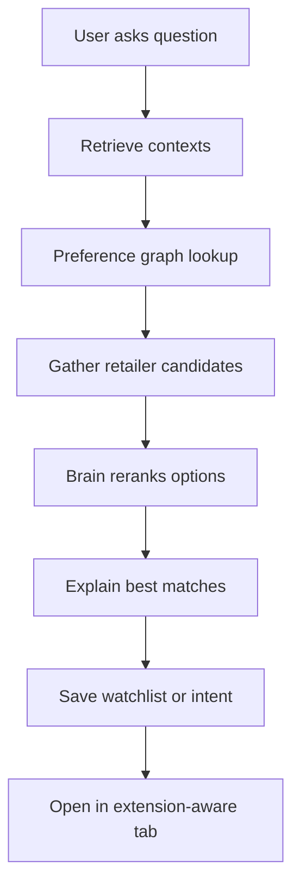
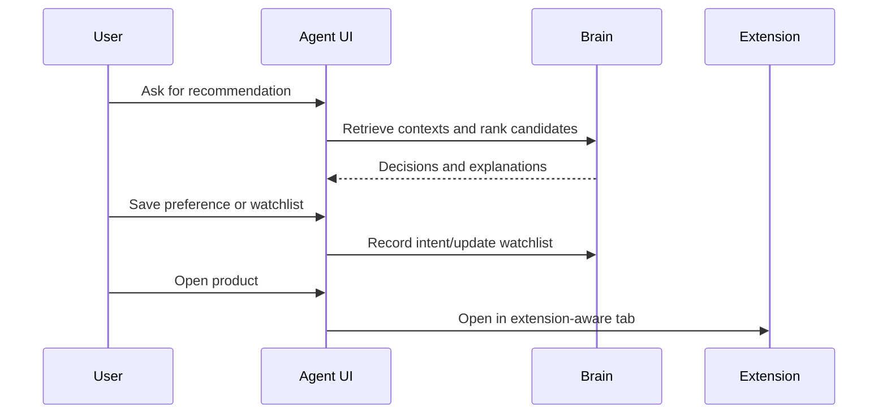

# RecoMe Agent Spec

## Objective

The RecoMe Agent should begin as a recommendation and planning companion that uses the same preference graph as the extension.

It should help users compare, understand, and track options before it ever attempts direct action.

## Product Position

The agent is not the primary product in v1.

The sequence should be:

1. extension proves value on page
2. brain proves durable memory
3. agent adds higher-level comparison and planning

## Primary Use Cases

- compare products across retailers
- answer shopping questions using user preferences
- explain best matches
- create and manage watchlists
- save explicit intent from conversation
- open selected products in extension-aware browsing flows

## Non-Goals for v1

- autonomous purchase
- full browser automation
- retailer login handling
- payment or checkout delegation
- replacing extension overlays on shopping pages

## Core User Stories

- As a shopper, I want to ask which option best fits me so I get a ranked answer grounded in my preferences.
- As a shopper, I want the agent to explain tradeoffs across products so I can compare quickly.
- As a shopper, I want to save a product for later so my future recommendation context improves.
- As a shopper, I want my conversational preferences to affect future page recommendations.

## Agent Workflow



## Inputs

The agent should use:

- current user question
- active contexts
- preference graph state
- explicit intents
- candidate products or offers
- watchlist state

## Outputs

The agent should return:

- ranked options
- short explanations
- key tradeoffs
- next actions such as save, compare, or open

## UX Model

### Response Structure

Recommended answer format:

- best match
- alternatives
- why this ranking
- what changed based on your preferences
- suggested next step

### Example response skeleton

```text
Best match: Product A
Why: You prefer durability over lowest price, and this brand has positive history in your profile.
Alternatives:
- Product B for lower budget
- Product C for lighter use
Next: Save to watchlist or open product page
```

## Agent Capabilities

### 1. Ask-and-rank

Given a category or shopping goal, return ranked products.

### 2. Compare-and-explain

Given multiple products, identify differences across:

- price
- shipping
- seller trust
- brand affinity
- feature fit

### 3. Watchlists

Users can:

- save products
- save categories
- save retailer-specific listings
- attach price or preference notes later

### 4. Intent updates from conversation

Examples:

- I already bought this kind of item
- I only need this once
- I prefer Sony for headphones
- Avoid low-rated third-party sellers

These statements should be normalized into IntentEvent records.

## Handoff to Extension

The agent should not complete the shopping flow itself in v1.

Instead it should hand off via:

- deep link to product page
- extension-aware open action
- optional compare list view later

### Handoff contract

```ts
type AgentOpenAction = {
  action: 'open_product' | 'open_compare' | 'save_watchlist';
  targetUrl?: string;
  candidateIds?: string[];
  metadata?: Record<string, unknown>;
};
```

## Retrieval Strategy

The agent should retrieve:

- matching intents
- relevant contexts
- relevant category history
- brand and seller preferences
- recent decisions for similar products

## Safety and Trust Rules

- Every recommendation must be explainable.
- The agent must not pretend certainty where entity resolution is weak.
- The agent must never purchase without explicit future product design and permission architecture.
- The agent must not silently create durable preferences from weak conversational cues.

## Suggested Data Flow



## Launch Criteria

The agent is ready for MVP only when:

- the brain schema is stable enough for shared access
- extension intent capture is already useful
- recommendations can be explained clearly
- the handoff back to browsing feels simple

## Future Directions

Only after trust and signal quality are proven:

- proactive watchlist alerts
- richer compare pages
- cross-retailer bundles
- guarded action suggestions
- eventually supervised purchase workflows
