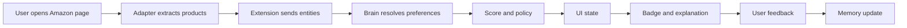
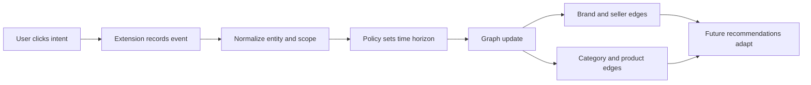
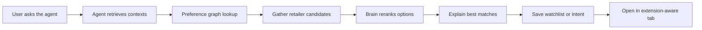
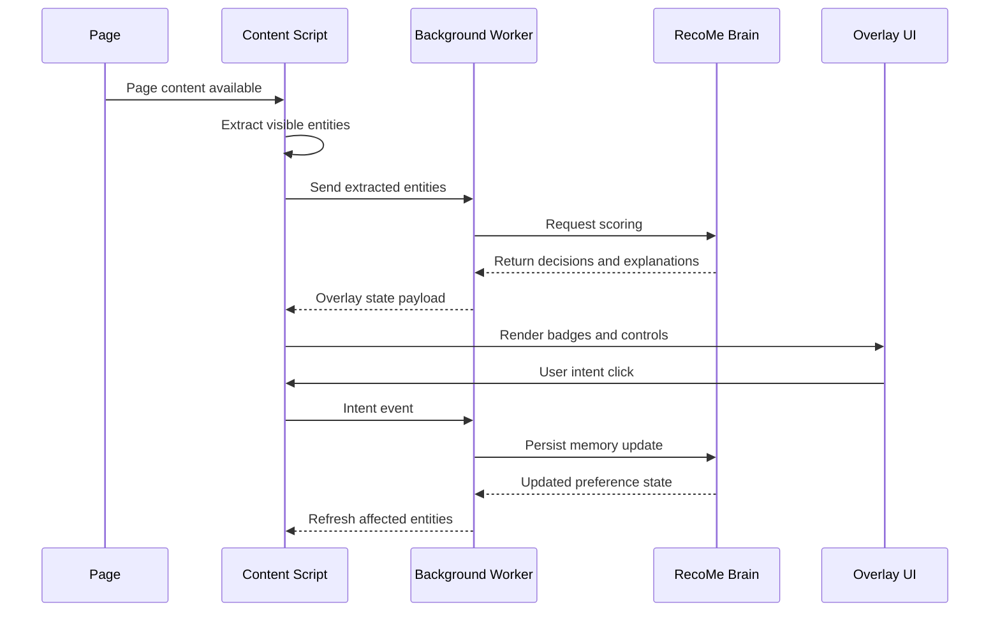
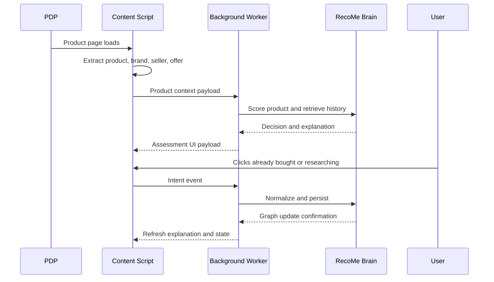
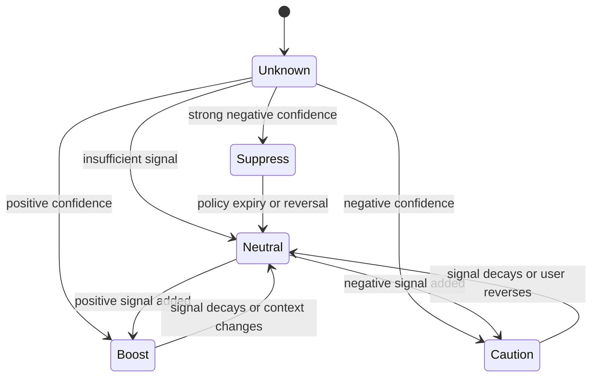

# RecoMe Flows and Diagrams

## Shopping Recommendation Flow

This is the extension-first loop and should define the first Amazon MVP.

## Intent Declaration Flow

RecoMe becomes defensible when users can explicitly correct the internet instead of only being inferred.

## Agent Flow

The agent should start as a recommendation and planning companion, not as an autonomous buyer.

## System Sequence for Search Results Page

## System Sequence for Product Detail Page

## Event Taxonomy

### Page Events

- page_loaded
- page_type_detected
- visible_entities_extracted
- extraction_failed

### Scoring Events

- score_requested
- score_completed
- score_failed
- explanation_generated

### User Intent Events

- intent_clicked
- intent_resolved
- intent_persisted
- intent_reverted

### Agent Events

- agent_query_submitted
- agent_candidates_gathered
- agent_rank_completed
- agent_watchlist_saved
- agent_open_action_triggered

## Decision State Machine

## Intent Scope Model

### Entity-level

Examples:

- this exact product
- this seller
- this brand

### Category-level

Examples:

- running shoes
- gaming headsets
- baby products

### Session-level

Examples:

- gift shopping
- researching
- budget sensitive today

## Testing Flows

### Happy Path

- user opens Amazon search page
- extension extracts products
- at least one badge appears
- user clicks not interested
- future similar products downgrade appropriately

### Reversal Path

- user marks product as already bought
- user later reverts or changes to interested
- scoring and explanations update cleanly

### Low-confidence Path

- extraction quality is partial
- extension renders neutral state
- user can still submit explicit intent

### Agent Handoff Path

- user asks for best option
- agent ranks products
- user opens top result
- extension recognizes product page and shows aligned reasoning
