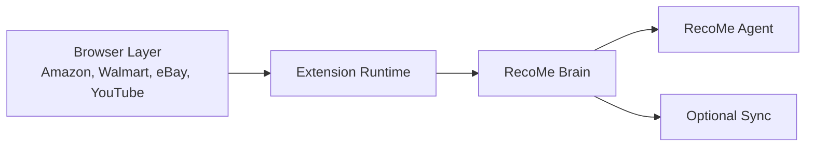
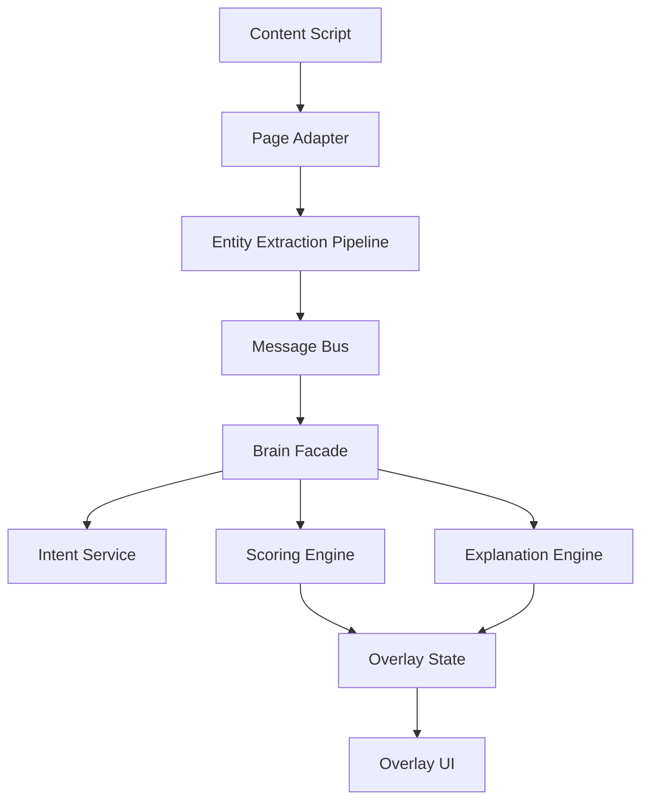

# RecoMe System Architecture

## Architecture Summary

RecoMe should start as a local-first architecture with clear seams for future sync and a separate agent surface.

## High-Level Stack



## Layer Responsibilities

### 1. Browser Layer
Examples:
- Amazon search results pages
- Amazon product detail pages
- Walmart product pages
- eBay listings
- future content surfaces like YouTube

Responsibilities:
- provide DOM surface for extraction
- expose recommendation units and page entities
- receive overlay UI from the extension

### 2. Extension Runtime
Core modules:
- MV3 service worker
- content scripts
- page adapters
- popup UI
- local cache
- message bus
- entity extraction pipeline

Responsibilities:
- detect supported surfaces
- load site-specific adapters
- read product and seller data from pages
- render badges, controls, and explanation UI
- capture feedback and intent actions
- call brain services locally

### 3. RecoMe Brain
Core modules:
- intent service
- preference graph
- context manager
- scoring engine
- policy engine
- explanation engine
- watchlist service

Responsibilities:
- store durable recommendation memory
- normalize entities across sites
- connect products, brands, sellers, and contexts
- generate decisions such as boost, neutral, caution, suppress
- explain each decision in user-readable text

### 4. RecoMe Agent
Core modules:
- conversational interface
- retrieval layer over preference graph
- recommendation orchestrator
- compare-and-rank workflow
- watchlist and follow-up actions

Responsibilities:
- answer shopping questions
- compare candidates across stores
- retrieve user context and preferences
- hand users back into extension-aware browsing flows

### 5. Optional Sync Layer
Core modules:
- encrypted profile sync
- watchlist sync
- import/export package service

Responsibilities:
- sync preference memory across devices later
- preserve portability
- keep the local-first MVP intact

## Recommended Repository Structure

```text
recome/
  extension/
    src/
      background/
      content/
      adapters/
      popup/
      overlay/
      shared/
  brain/
    src/
      entities/
      graph/
      scoring/
      policy/
      explain/
      storage/
  agent/
    src/
      chat/
      retrieval/
      compare/
      watchlist/
  packages/
    schema/
    ui/
    utils/
```

## Runtime Topology



## Design Principles

### Local-first by default
- Core recommendation logic must work without a cloud dependency.
- Storage should begin in browser-managed local storage or IndexedDB.
- Import and export should exist before sync.

### Shared schema early
- Product, offer, brand, seller, context, and intent schemas must be defined once.
- Extension and agent should read and write the same semantic objects.

### Adapter-based page integration
- Every supported website should have its own adapter.
- Shared extraction utilities should exist, but selectors and heuristics should remain site-specific.

### Explainability at the decision boundary
- Every visible badge or ranking change must be explainable in one sentence.
- The reason shown to the user must be derived from the same decision record used by the engine.

### Policy before autonomy
- User intent, time horizon, and safety policy must be checked before any future action system is allowed.

## Technical Decisions

### Browser platform
Recommended first target:
- Chrome Manifest V3

Future targets:
- Edge
- Brave
- Firefox with compatibility review later

### Storage
Recommended v1:
- IndexedDB for normalized entities, intents, contexts, graph edges, and decision history
- chrome.storage.local for user settings and lightweight feature flags

### Inter-process communication
Use:
- typed message contracts between content scripts, background worker, popup, and overlay

### Schema distribution
Use:
- shared TypeScript package for all core domain models

## Core Interfaces

### Extension to Brain interface
Operations:
- extractEntities(pageSnapshot)
- scoreEntities(entities, context)
- recordIntent(intentEvent)
- explainDecision(decisionId)
- getRecommendations(pageContext)

### Agent to Brain interface
Operations:
- getUserContext(queryContext)
- compareCandidates(candidateList, context)
- createWatchlist(watchRequest)
- updatePreferenceFromConversation(intentEvent)
- openInExtensionContext(target)

## Non-Goals for v1 Architecture
- no autonomous checkout system
- no retailer account automation
- no mandatory backend to use the extension
- no generalized browser computer-use agent inside the extension runtime
